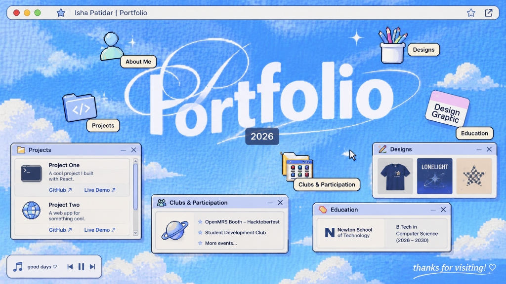

# Isha Patidar — Personal Portfolio ☁️✨

A nostalgic, retro early-2000s desktop portfolio website crafted with React, TypeScript, Vite, and Tailwind CSS. Faithfully recreates a playful pastel Y2K desktop interface with interactive draggable windows, floating illustrated icons, lo-fi synthesizer audio, and dynamic showcases.



## 🎨 Features

- **Retro Desktop Aesthetic**: Vivid pastel sky, fluffy pixel clouds, subtle print grain, scanlines, and early-2000s chrome.
- **Interactive Retro Windows**:
  - 📁 **Projects**: Interactive cards with live links (`GitHub ↗`, `Live Demo ↗`) and tech stack tags.
  - 👥 **Clubs & Participation**: Expandable event list featuring OpenMRS Booth at Hacktoberfest and the Student Development Club.
  - ✏️ **Designs**: Visual gallery featuring merchandise, apparel, posters, and graphic art with full-screen lightbox preview.
  - 🏷️ **Education**: Newton School of Technology B.Tech Computer Science profile and coursework.
  - 👤 **About Me**: Interactive bio with technical skills, learning goals, and passions (including Formula 1 🏎️).
- **Draggable & Closable Windows**: Windows can be dragged across the desktop, focused, minimized, and closed.
- **Floating Illustrated Icons**: Whimsical illustrated desktop icons with gentle sinusoidal floating animations and cream label pills.
- **Interactive Lo-Fi Music Player**: Embedded audio player with procedural Web Audio API synthesizers playing chill lo-fi ambient tracks.
- **Retro Browser Bar**: Functional window controls (reset, minimize all, tile), bookmarking, and link sharing with toast confirmation.
- **Whimsical Details**: Clickable cursive sign-off with heart/star confetti bursts.

## 🛠️ Built With

- **Framework**: [React 18](https://react.dev/) + [TypeScript](https://www.typescriptlang.org/)
- **Build Tool**: [Vite 6](https://vitejs.dev/)
- **Styling**: [Tailwind CSS](https://tailwindcss.com/)
- **Icons**: Custom Pixel Art + [Lucide React](https://lucide.dev/)
- **Audio**: Web Audio API (Synthesizer Chords)

## 🚀 Getting Started

### Prerequisites

- [Node.js](https://nodejs.org/) (v18 or newer)
- npm or yarn / pnpm / bun

### Installation

1. Clone the repository:
   ```bash
   git clone https://github.com/<your-username>/portfolio.git
   cd portfolio
   ```

2. Install dependencies:
   ```bash
   npm install
   ```

3. Start development server:
   ```bash
   npm run dev
   ```

4. Open your browser at `http://localhost:5173`.

### Production Build

```bash
npm run build
```

## 📄 License

MIT © [Isha Patidar](https://github.com/ishapatidar)

